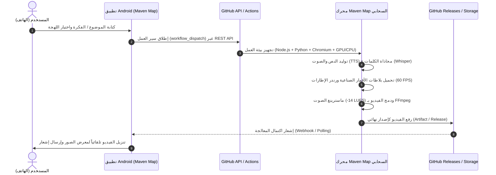
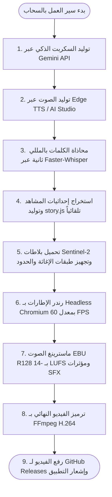

# خطة معمارية شاملة: تطبيق أندرويد لإنتاج فيديوهات الخرائط الفضائية (Maven Map Studio)

> [!NOTE]
> هذه الخطة المعمارية مصممة لبناء استوديو إنتاج مستقل بالكامل يتيح لك إنشاء فيديوهات الخرائط الجغرافية ثلاثية الأبعاد (Maven Map) مباشرة من هاتفك الأندرويد، بالاعتماد على نفس المعمارية السحابية الذكية الناجحة في مشروع **Stickman Studio** (تطبيق أندرويد خفيف + رندر سحابي فائق السرعة عبر GitHub Actions).

---

## 1. الرؤية المعمارية وسير العمل (High-Level Architecture)

المشروع ينقسم إلى قطاعين رئيسيين يكمل أحدهما الآخر:
1. **واجهة التحكم (Android App - Client)**: تطبيق بهندسة حديثة (Jetpack Compose) يدير المدخلات، يختار المواضيع واللهجات، يضبط المسارات الجغرافية، ويرسل إشارات البدء (Workflow Dispatch).
2. **محرك الإنتاج السحابي (Cloud Pipeline - GitHub Actions)**: بيئة مؤتمتة تمتلك كفاءة معالجة ضخمة مجانية، تتكفل بتوليد الصوت، محاذاة التوقيت بالمللي ثانية، تحميل صور الأقمار الصناعية (Sentinel-2)، رندر الإطارات بدقة 1080x1920 بمعدل 60 إطاراً في الثانية، ماسترينغ الصوت لـ -14 LUFS، وإرسال الفيديو النهائي للهاتف.



---

## 2. معمارية تطبيق الأندرويد (Android Client Architecture)

التطبيق سيعتمد أحدث معايير **Android Modern Architecture (MVVM + Clean Architecture)** مع مكتبات Google الرسمية:

```
app/
├── data/
│   ├── api/             # Retrofit/Ktor لـ GitHub REST API v3
│   ├── model/           # كائنات البيانات (Job, StoryConfig, Release)
│   └── repository/      # إدارة الاتصال ومفاتيح GitHub المشفرة
├── domain/
│   ├── usecase/         # منطق إنشاء الفيديو، فحص الحالة، التنزيل
│   └── geocoding/       # البحث عن إحداثيات المدن والمضائق محلياً
├── ui/
│   ├── theme/           # Material 3 Dark Theme مخصص للاستوديو
│   ├── screens/
│   │   ├── home/        # لوحة التحكم ومتابعة الفيديوهات الجارية
│   │   ├── create/      # إدخال الفكرة، اللهجة، وتحديد مسار الكاميرا
│   │   └── player/      # مشغل فيديو ExoPlayer ومعاينة النتائج
│   └── components/      # بطاقات الحالة، مؤشرات التقدم، أزرار التحكم
└── workers/             # WorkManager للمراقبة والتنزيل في الخلفية
```

### الميزات البرمجية للتطبيق:
- **واجهة مستخدم عصرية (Jetpack Compose + Material 3)**: تصميم مظلم تفاعلي يناسب صناع المحتوى.
- **تأمين الاعتمادات (EncryptedSharedPreferences / Jetpack Security)**: حفظ توكن GitHub الشخصي (Personal Access Token) بشكل مشفر داخل شريحة الأمان بالهاتف.
- **إدارة التنزيل والمراقبة في الخلفية (WorkManager)**:
  - لا حاجة لترك التطبيق مفتوحاً.
  - يقوم `WorkManager` بفحص حالة سير العمل دورياً عبر الـ API.
  - بمجرد اكتمال الرندر، يقوم بتحميل الـ MP4 مباشرة إلى مسار المعرض: `/sdcard/Movies/MavenMap/`.
  - إرسال إشعار فوري للمستخدم (Push Notification) مع إمكانية التشغيل أو المشاركة الفورية بضغطة زر.

---

## 3. محرك الرندر والأتمتة السحابية (GitHub Actions Cloud Pipeline)

مستودع المشروع السحابي سيحتوي على الأكواد ومخططات سير العمل:

### ملفات سير العمل (`.github/workflows/`):
1. **`produce.yml` (الإنتاج الفوري بطلب المستخدم)**:
   - يُستدعى بواسطة `workflow_dispatch` عبر التطبيق، ويستقبل مدخلات:
     - `topic`: موضوع الفيديو (مثال: "مضيق باب المندب وأهميته العالمية").
     - `dialect`: اللهجة المختارة (المصرية `ar-EG`، المغربية `ar-MA`، الفصحى `ar-SA`، إلخ).
     - `voice_engine`: محرك الصوت (Google AI Studio أو Edge TTS).
     - `duration`: المدة المستهدفة (60 إلى 90 ثانية).
2. **`nightly.yml` (الإنتاج الليلي التلقائي - Night Mode)**:
   - يعمل بجدولة زمنية `cron` (مثلاً الساعة 02:00 صباحاً).
   - يقرأ قائمة أفكار موضوعة في ملف مهام أو يستخرج أبرز الأخبار الجغرافية والسياسية تلقائياً.
   - يولد الفيديوهات وينشرها تلقائياً لتكون جاهزة للمستخدم فور استيقاظه صباحاً في معرض الهاتف.



---

## 4. المكون الذكي: محول الأفكار إلى مسارات كاميرا (AI Story Builder)

أهم ابتكار في هذه المعمارية هو **تحويل الفكرة البشرية إلى كود قصة خريطة (`story.js`) آلياً**:
- بدلاً من كتابة إحداثيات الكاميرا والمسافات يدوياً، نوفر كود بايثون معزز بنموذج ذكاء اصطناعي (Gemini 2.5 Flash) مزود بـ `Function Calling / Structured Outputs`:
  - يحدد المواقع الجغرافية المذكورة في النص (خط الطول، العرض، والارتفاع المناسب للكاميرا).
  - يحدد الحدود السياسية التي تحتاج إلى تلوين.
  - يرسم المسارات المائية والبرية ومسافات الرادار/المساطر تلقائياً.
  - يزامن ظهور العناصر مع توقيت الكلمات المستخرج من Whisper.

---

## 5. خطة التنفيذ خطوة بخطوة (Phased Roadmap)

| المرحلة | الأهداف الرئيسية | المخرجات |
| :--- | :--- | :--- |
| **المرحلة الأولى: إعداد الهيكل السحابي** | - إنشاء مستودع `maven-map-studio` على GitHub.<br>- ضبط مجلد المحرك (Engine) ونصوص البناء.<br>- إعداد ملف `.github/workflows/produce.yml` واختبار الرندر السحابي التلقائي. | سير عمل سحابي ينتج فيديو كامل بضغطة زر من GitHub مباشرة. |
| **المرحلة الثانية: بناء تطبيق الأندرويد الأساسي** | - تهيئة مشروع Android جديد (Kotlin + Jetpack Compose).<br>- ربط واجهة REST API مع GitHub لتسجيل الدخول وإطلاق الـ Actions.<br>- شاشة إدخال الفكرة واللهجة وخيارات الإنتاج. | تطبيق يرسل طلب إنتاج لـ GitHub Actions بنجاح من شاشة الهاتف. |
| **المرحلة الثالثة: نظام التنزيل والتنبيهات** | - برمجة `WorkManager` لمراقبة حالة الوظيفة السحابية.<br>- تحميل الفيديو وحفظه في `/sdcard/Movies/MavenMap/`.<br>- إرسال إشعار محلي مع مشغل الفيديو (ExoPlayer). | المستخدم يطلب الفيديو من الهاتف، فيصله إشعار وتنزيل تلقائي فور انتهائه. |
| **المرحلة الرابعة: ميزات متقدمة ومعاينة المسار** | - إضافة ميزة المعاينة ثنائية الأبعاد للمسار (2D Map Preview).<br>- تفعيل وضع الإنتاج الليلي (Night Queue).<br>- إضافة مكتبة متكاملة للمؤثرات الصوتية (SFX Pack) لتحسين الجودة السمعية. | تطبيق متكامل لا يحتاج إلى تشغيل الكمبيوتر نهائياً. |

---

> [!TIP]
> **التكلفة والموارد**: هذا النظام يعمل **بشكل مجاني تماماً**؛ حيث أن حساب GitHub يوفر آلاف الدقائق المجانية شهرياً لـ GitHub Actions، ورندر الفيديو الواحد (بمعدل 60 FPS) يستغرق حوالي 2 إلى 3 دقائق فقط على خوادم السحاب!
