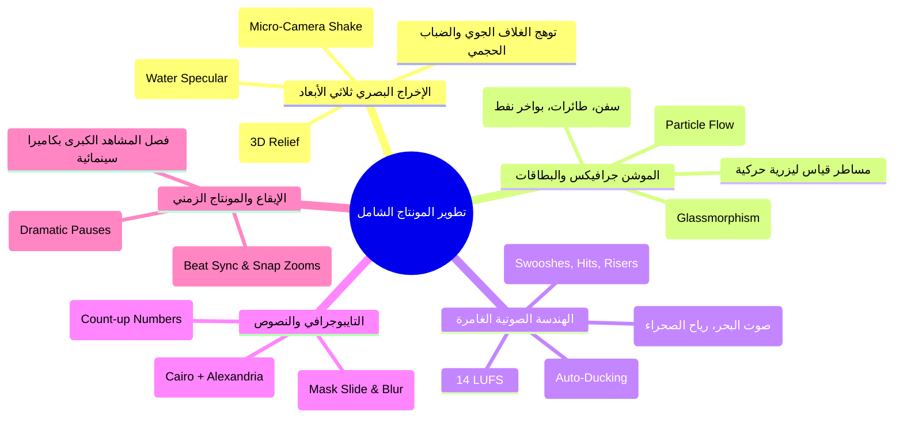

# الخطة الشاملة لتطوير المونتاج والإخراج السينمائي (Masterclass Montage Upgrade Plan)

> [!NOTE]
> هذه الخطة مخصصة لنقل مونتاج وإخراج فيديوهات الخرائط ثلاثية الأبعاد (Maven Map) من المستوى البرمجي الجيد إلى **أعلى مستوى سينمائي عالمي**، منافس لأكبر القنوات الوثائقية والجيوسياسية على يوتيوب وتيك توك (مثل: *Vox*, *Johnny Harris*, *Magnates Media*, *RealLifeLore*, *Fern*).

---

## 1. محاور التطوير الخمسة (The 5 Core Pillars)



---

## 2. المحور الأول: الإخراج البصري وكاميرا العالم الافتراضي (Cinematic 3D Visuals)

### 1. الإضاءة الجوية وظلال التضاريس (Atmosphere & Lighting):
- **توهج الغلاف الجوي (Atmospheric Rim Glow)**: إضافة هالة زرقاء ناعمة على أطراف كوكب الأرض عند زوايا الكاميرا المائلة (Low Angle Orbit).
- **محاكاة ضوء الشمس الحقيقي (Directional Sunlight)**: توجيه زاوية الإضاءة لتلقي الجبال وسلاسل التضاريس (مثل جبال اليمن وإريتريا) بظلال ثلاثية الأبعاد حقيقية تعطي إحساساً بالعمق والفخامة.
- **بريق وتوهج مياه البحر (Water Specular & Ripple)**: مياه البحر الأحمر وخليج عدن لا تكون مجرد مسطح أزرق مصمت، بل مسطح يعكس لمعان الضوء مع حركة أمواج خفيفة.

### 2. فيزياء الكاميرا والحركة الواقعية (Realistic Camera Dynamics):
- **حركات كبس الكاميرا (Snap Punch-ins)**: عند الكلمات الصادمة والمفصلية في السرد (مثلاً: *"في ثواني!"* أو *"لو اتقفل!"*)، تقوم الكاميرا بقفزة تقريب سريعة بنسبة 1.15x مع عودة سلسة لإشعال انتباه المشاهد.
- **الاهتزاز البشري الطبيعي (Natural Micro-Drift)**: في اللقطات المقربة الثابتة (مثل لقطة جزيرة بريم)، تتحرك الكاميرا ببطء شديد وتذبذب عضوي دقيق يحاكي تصوير المروحيات أو طائرات الدرون، مما يلغي المظهر البرمجي الجاف.

---

## 3. المحور الثاني: الموشن جرافيكس وعناصر العرض الفاخرة (High-End Motion Graphics)

### 1. البطاقات الزجاجية الحديثة (Glassmorphic Info Badges):
- تصميم لوحات البيانات بنمط الزجاج المصنفر (`Glassmorphism`):
  - خلفية شبه شفافة مع تمويه للخرائط التي تقع تحتها (`backdrop blur`).
  - حواف ذهبية أو نيون ناعمة تبرز فوق الأقمار الصناعية.
  - أيقونات مجسمة ثلاثية الأبعاد (علامات تحذيرية، براميل نفط، أعلام دول).

### 2. خطوط التجارة وحركة السفن بالجسيمات (Particle Pulse Lines):
- استبدال الخطوط المتقطعة الثابتة بـ **مسارات طاقة متدفقة (Flowing Particle Trails)**:
  - نقاط مضيئة تتحرك باستمرار على طول مسار الشحن في البحر الأحمر تمثل حركة السفن الحية.
  - تدرج لوني يعكس الكثافة: الأزرق السماوي للتجارة العادية، والأحمر المتوهج للتهديدات أو الالتفاف.

### 3. المساطر الذكية وأشعة الرادار (Laser Measurement Rulers):
- مسطرة القياس (مثل مسطرة الـ 3 كم ومسطرة الـ 20 كم) تبدأ بنبضة ضوئية تنطلق من الساحل الأول وترتطم بالساحل الثاني وتترك خط ليزر متوهجاً مع عداد رقمي متصاعد ينتهي بالقيمة المضبوطة.

---

## 4. المحور الثالث: التصميم الصوتي الملحمي (Epic Sound Design & Foley)

> [!TIP]
> 50% من تأثير المونتاج السينمائي يكمن في الصوت. في فيديوهات الخرائط، كل حركة بصرية يجب أن يكون لها "وزن صوتي".

```
مكتبة المؤثرات الصوتية المقترحة (Maven SFX Suite):
├── transitions/
│   ├── sub_drop_heavy.wav     # ضربة باس سينمائية عند الهبوط من الفضاء
│   ├── whoosh_cinematic.wav   # صوت الهواء السريع عند تحرك الكاميرا
│   └── camera_snap.wav        # صوت عدسة التقريب عند التثبيت المفاجئ
├── interface/
│   ├── radar_sonar_ping.wav   # رنين السونار عند تحديد المضيق أو السفن
│   ├── digital_counter.wav    # تكتكة العداد السريعة عند صعود الأرقام (21,000)
│   └── warning_alarm.wav      # تنبيه ناعم عند ظهور علامات الخطر والصواريخ
└── environment/
    ├── sea_deep_breeze.wav    # هواء البحر الهادئ في خلفية المشاهد المائية
    └── desert_wind_loop.wav   # هواء الصحراء الخفيف لمشاهد الربع الخالي
```

### نظام الخفض الصوتي الذكي (Dynamic Auto-Ducking):
- ضبط سكربت الماسترينغ `mix.py` لخفض تلقائي لجميع المؤثرات الصوتية والموسيقى التصويرية بمقدار **-12 dB** لحظة كلام المعلق، ورفعها تلقائياً وبقوة في اللحظات الفاصلة بين الجمل لتعطي أثراً درامياً مذهلاً.

---

## 5. المحور الرابع: التايبوجرافي ونصوص الجذب الحركية (Kinetic Typography)

- **استثمار خطي القاهرة والإسكندرية بأقصى درجات الإبداع**:
  - **عناوين المشاهد**: العنوان لا يظهر فجأة، بل يرتفع بنعومة من الأسفل للأعلى مع تلاشي للتمويه (`Blur-to-Focus Animation`).
  - **الكلمات المميزة (Color Accent)**: تلوين الكلمات الصادمة باللون الأصفر الذهبي `#FFD23F` أو الأحمر الناري `#FF4757` مع إبقاء باقي النص بالأبيض النقي.
  - **العدادات الرقمية المتصاعدة (Rolling Numbers)**: عندما ينطق المعلق "واحد وعشرين ألف سفينة"، يبدأ الرقم في الصعود المتسارع من 0 إلى 21,000 في غضون ثانية واحدة، مما يمنح إحساساً حقيقياً بضخامة الرقم.

---

## 6. خطة التطبيق والترقية على ثلاث مراحل (Action Plan)

| المرحلة | المهام البرمجية والفنية | النتيجة الملموسة |
| :--- | :--- | :--- |
| **المرحلة 1: الترقية الصوتية وتكامل الـ SFX** | - تحميل وتضمين حزمة الـ SFX السينمائية المذكورة في مجلد `engine/sfx/`.<br>- ربط مؤثرات الانتقال والسونار بتوقيتات `timing.json` في `mix.py`. | مقاطع صوتية ممتعة جداً للأذن مع ضربات باس واقعية تحبس الأنفاس. |
| **المرحلة 2: تطوير كود Three.js والبطاقات** | - إضافة تظليل التضاريس المباشر (Hillshade Relief Shadows).<br>- برمجة تأثير الزجاج المصنفر للبطاقات في `map.js`.<br>- برمجة عداد الأرقام المتصاعد (Counter Animation). | قفزة هائلة في نقاء المشهد وعصرية البطاقات التوضيحية. |
| **المرحلة 3: ديناميكية الكاميرا والانتقالات** | - إضافة اهتزاز الكاميرا الطبيعي (Camera Micro-Drift).<br>- إضافة حركات التقريب السريع (Punch-ins) في اللحظات الحماسية.<br>- تفعيل الجسيمات المتدفقة لخطوط الشحن. | فيديو يبدو كأنه صُنع في استوديوهات نتفلكس أو ناشيونال جيوغرافيك. |
